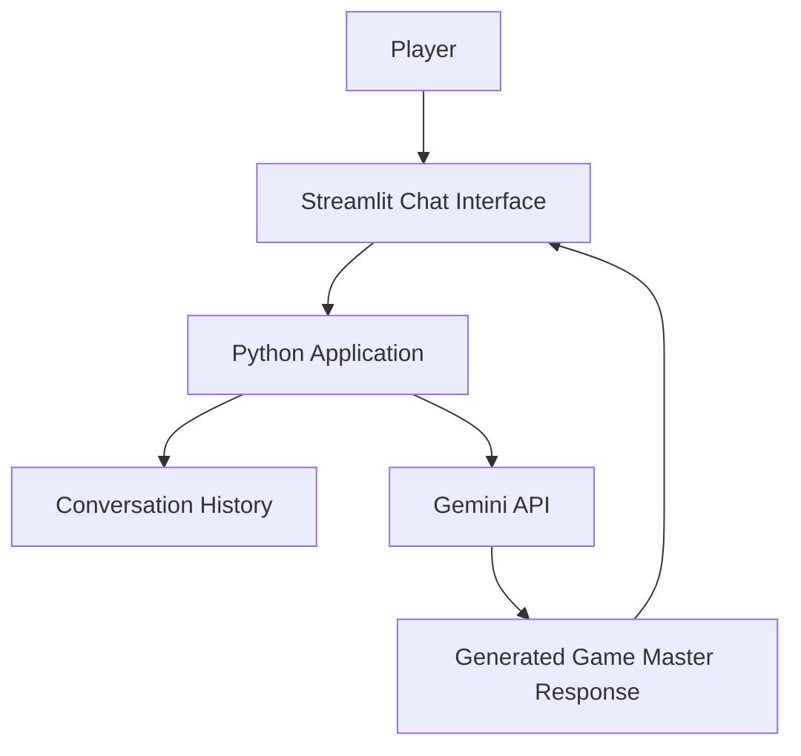
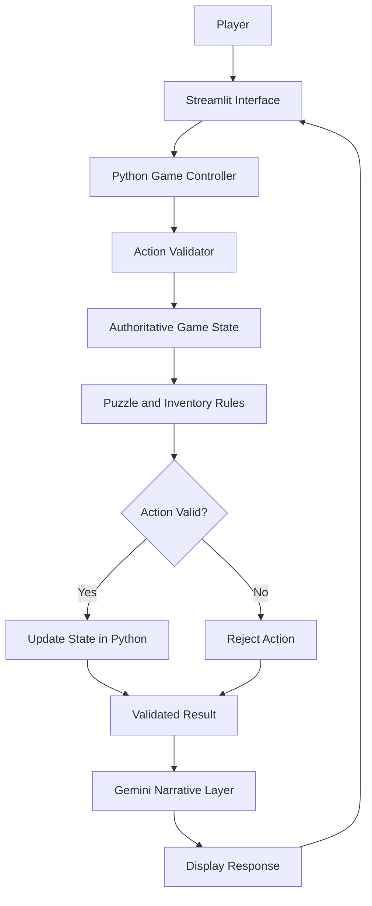

# System Architecture

## Version 1 — Conversational AI Game Master

The player sends natural-language messages through Streamlit. The Python application includes the conversation history and game instructions in a Gemini request. Gemini generates the Game Master's reply. Version 1 is a baseline and assumes normal good-faith play.

## Version 2 — Python-Controlled Reliable Game

Python validates all actions and owns the game state. Gemini receives the already validated result and may only narrate it. If Gemini is unavailable, Python's validated message is displayed.
